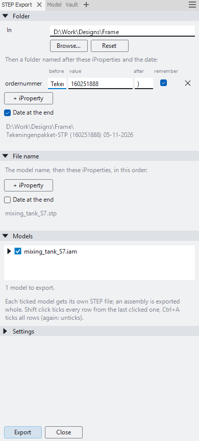

# Inventor Exporter

Mass export for Autodesk Inventor 2025: STEP, IFC and every other 3D format Inventor writes. Tick the assemblies and
parts you want in a model tree, tick the formats, click **Export**, and each model becomes its own file per format,
with a file name and folder made from your iProperties and the date.

## Install

Close Inventor and run `Exporter-Setup-<version>.exe` from
[Releases](https://github.com/JanTrueno/Inventor-STEP-Export/releases). It installs for the current user, with no
admin rights needed. The **Exporter** button is on the Assemble tab of an assembly, the 3D Model and Sheet Metal tabs of a
part, and the Place Views tab of a drawing.

## Use

- **Models**: the open assembly is ticked, or in a drawing the assembly on sheet 1. Open the tree to tick parts and
  subassemblies too. **Shift**-click ticks every row from the last row you clicked, and **Ctrl+A** ticks all rows.
  Each ticked model gets its own file per format (an assembly is exported whole), and a file used more than once
  is exported once.
- **Formats**: STEP, IFC, glTF (.glb), OBJ, STL, DWG (3D solids), IGES, SAT, Parasolid x_t/x_b, JT, USDZ, DWF, CATIA V5,
  Granite, Pro/E Neutral, SMT and QIF (parts), through Inventor's own translators. In a drawing, the drawing itself
  can also go to PDF, DWG, DXF (one file per sheet), DWF or DWFx.
- **IFC** (IFC4, mm) is written by the add-in, since Inventor's IFC translator only imports. It keeps the assembly
  tree as `IfcElementAssembly`. Parts become `IfcPlate` (sheet metal and plates, type `PL<thickness>`), `IfcMember`
  (Frame Generator and other profiles, type = family and size) or `IfcBuildingElementProxy`. Each part carries the
  property set `Onderdeel` (part number, description, profile, material, length, thickness, volume, weight), base
  quantities and its material. A part's mesh is stored once and placed per instance. Suppressed, hidden and
  reference components, and components named after a "leave out" word (`vloerplan`), are not exported.
- **Folder**: a folder is made in the folder of the open assembly or drawing, named after iProperties and the date.
  At first that is `Tekeningenpakket-STP (<ordernummer>) <dd-MM-yyyy>`. **Browse…** picks another place.
- **File name**: the model name, optionally followed by iProperties and the date, for example
  `Frame_160261496_2026-11-05.stp`.
- **iProperty rows** (folder and file name): **+ iProperty** adds one, and each row has text **before** and
  **after** the value. A value you type is used for every model; left alone, each model uses its own iProperty.
  **Remember** keeps the typed value for next time. Empty values drop out, and `160100` is refused as "not
  filled in".
- **Export** asks before overwriting files and shows a progress bar you can cancel. Rows show **In folder**,
  **Exported** or **Failed**.

**Settings** (folded up) hold the separators, date formats, the placeholder, the STEP protocol (AP214 by default, or
AP203 or AP242) and `.stp` or `.step`, and for IFC the leave-out words, the mesh accuracy (0.1 mm) and the property
set name. They are saved in `%APPDATA%\StepExport\settings.json`, and problems are
logged in `%LOCALAPPDATA%\StepExport\log.txt`.

 

## Build

Requires the .NET 8 SDK. With Inventor closed, `install.ps1` builds and installs the add-in (`-Remove` uninstalls
it). `build-installer.ps1` (Inno Setup 6) writes `dist\StepExport-Setup-<version>.exe`.

License: GPL-3.0. Third-party icons: see `THIRD-PARTY-NOTICES.txt`.
